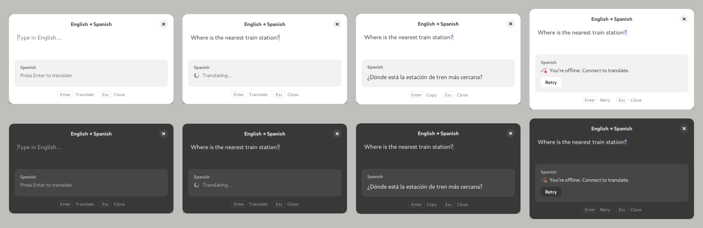

# Quick Translate

Ventana emergente para GNOME que traduce texto en inglés. Pulsas un atajo global, escribes, pulsas **Enter** para traducir y **Enter** otra vez para copiar la traducción. **Esc** cierra la ventana.

Está hecha en Python con GTK 4 y libadwaita, y sigue el diseño **1b, “Stacked dialog”** de `project/Translator Popup.dc.html`. Tiene tema claro y oscuro, que sigue al del sistema.



## Requisitos

- GNOME (o cualquier escritorio con GTK 4), en Wayland o X11
- Python 3.11 o posterior, PyGObject, GTK 4 y libadwaita 1.4 o posterior

```sh
# Ubuntu 24.04+ / Debian 13+
sudo apt install python3-gi gir1.2-gtk-4.0 gir1.2-adw-1
# Fedora
sudo dnf install python3-gobject gtk4 libadwaita
# Arch
sudo pacman -S python-gobject gtk4 libadwaita
```

No hay dependencias de pip: las peticiones HTTP usan la biblioteca estándar.

## Instalación

```sh
./install.sh
```

El script instala la app para tu usuario y hace lo siguiente:

- copia el paquete a `~/.local/share/quick-translate` y crea el comando `~/.local/bin/quick-translate`
- añade la app al menú de aplicaciones
- la arranca oculta al iniciar sesión, para que el atajo la abra al instante
- crea el atajo global **Super+Shift+T** en *Configuración → Teclado → Atajos personalizados*

Si prefieres otro atajo, usa `SHORTCUT='<Control><Alt>e' ./install.sh`. Para instalar sin atajo, usa `./install.sh --no-shortcut`, y para desinstalar, `./install.sh --uninstall`. Tu configuración se conserva al desinstalar.

Para probarla sin instalar, ejecuta `python3 -m quick_translate` desde esta carpeta.

## Uso

| Tecla | Acción |
|---|---|
| Enter | Traduce. Con una traducción a la vista, la copia. Tras un error, reintenta |
| Shift+Enter | Inserta un salto de línea |
| Esc | Cierra la ventana |
| Ctrl+Q | Cierra la app del todo |

- Si vuelves a pulsar el atajo con la ventana abierta, se cierra.
- Al reabrirla, aparece el último texto seleccionado, así que basta con escribir encima.
- Si editas el texto después de traducir, la traducción anterior se atenúa y Enter vuelve a traducir.
- La app sigue en segundo plano al cerrar la ventana, para abrirse rápido y para que el portapapeles conserve lo que copiaste. `quick-translate --quit` la detiene.

## Configuración y servicios de traducción

Al abrir la ventana por primera vez se crea `~/.config/quick-translate/config.toml`. Los cambios se aplican la próxima vez que se abre la ventana, sin reiniciar.

```toml
target_language = "Spanish"     # o un código: "de", "fr", "ja"…
backend = "mymemory"            # "mymemory", "libretranslate" o "deepl"
api_key = ""                    # o QUICK_TRANSLATE_API_KEY / DEEPL_API_KEY
url = ""                        # servidor propio de LibreTranslate
email = ""                      # MyMemory: sube el límite gratuito
show_key_hints = true           # pie con los atajos Enter / Esc
close_on_focus_loss = true      # cerrar al perder el foco, como un lanzador
close_after_copy = false        # cerrar después de copiar
```

| Servicio | Clave | Notas |
|---|---|---|
| **MyMemory** (predeterminado) | No | Gratis, unos 5.000 caracteres al día; con `email`, 50.000 |
| **LibreTranslate** | Según el servidor | Puedes alojarlo tú (`url = "http://localhost:5000"`) o usar libretranslate.com con clave |
| **DeepL** | Sí | Las claves gratuitas (terminadas en `:fx`) usan `api-free.deepl.com` automáticamente |

Los errores se muestran en la tarjeta de traducción. Si no hay conexión verás “You’re offline. Connect to translate.” y un botón **Retry**. Si el servicio devuelve un error, como una clave no válida o el límite agotado, verás su mensaje.

## Notas sobre GNOME

- **Centrado:** en Wayland las apps no pueden elegir dónde se colocan sus ventanas. Para que la ventana aparezca centrada como en el diseño, ejecuta `gsettings set org.gnome.mutter center-new-windows true`.
- **Atajo global:** GNOME no deja que una app registre su propio atajo global, así que el instalador crea un atajo personalizado que ejecuta `quick-translate`. Como la app tiene una sola instancia, ese comando abre la ventana o la cierra.

## Desarrollo

```sh
python3 -m unittest discover -s tests -t .
```

Estructura:

- `quick_translate/app.py`: aplicación de instancia única, opciones `--background` y `--quit`, y tema claro u oscuro
- `quick_translate/window.py`: la ventana (diseño 1b) y sus estados: vacío, traduciendo, resultado y error
- `quick_translate/style.py`: colores y CSS del diseño
- `quick_translate/translators.py`: backends MyMemory, LibreTranslate y DeepL
- `quick_translate/config.py`: lectura de `config.toml`
- `project/` y `chats/`: el diseño original de Claude Design (`project/HANDOFF.md`)
