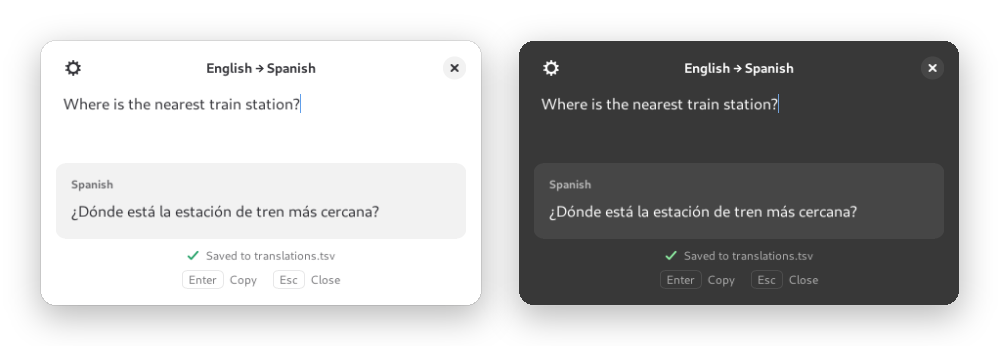
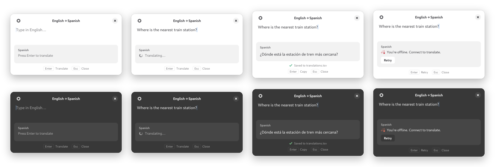
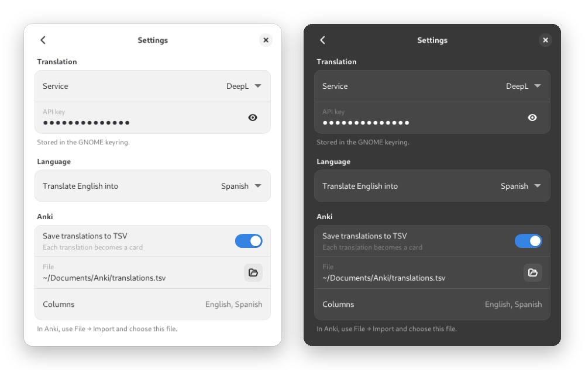

<h1 align="center">Quick Translate</h1>

<p align="center">
  <strong>Traduce del inglés sin salir de lo que estás haciendo.</strong><br>
  Una ventana emergente para GNOME: pulsas un atajo, escribes y pulsas Enter.
</p>

<p align="center">
  
  
  
</p>

<p align="center">
  
</p>

<p align="center">
  <a href="#instalacion">Instalación</a> ·
  <a href="#uso">Uso</a> ·
  <a href="#ajustes">Ajustes</a> ·
  <a href="#anki">Anki</a> ·
  <a href="#servicios">Servicios</a> ·
  <a href="#problemas">Problemas</a>
</p>

---

## ✨ Qué hace

- **Atajo global:** <kbd>Super</kbd>+<kbd>Shift</kbd>+<kbd>T</kbd> abre la ventana desde cualquier sitio y vuelve a cerrarla.
- **Todo con el teclado:** <kbd>Enter</kbd> traduce, otro <kbd>Enter</kbd> copia la traducción y <kbd>Esc</kbd> cierra.
- **Varios servicios:** DeepL, Google Cloud Translation, LibreTranslate o MyMemory, que es gratis y no necesita clave.
- **Más de 30 idiomas de destino**, que eliges en los ajustes.
- **Para Anki:** cada traducción puede ir a un fichero TSV listo para importar como tarjetas.
- **Claves en el llavero de GNOME**, no en texto plano.
- **Aspecto de GNOME:** usa libadwaita y cambia entre tema claro y oscuro al momento, junto con el sistema.
- **Sin dependencias de pip**: solo usa los paquetes de tu distribución.

## 📸 Capturas

<p align="center">
  
  <br>
  <sub>Vacía · Traduciendo · Resultado guardado para Anki · Sin conexión</sub>
</p>

<p align="center">
  
  <br>
  <sub>Ajustes, que se abren desde el engranaje de la cabecera</sub>
</p>

<a id="instalacion"></a>

## 📦 Instalación

### 1. Dependencias

Necesitas Python 3.11 o posterior, GTK 4, libadwaita 1.4 o posterior y libsecret. Funciona en Ubuntu 24.04, Debian 13, Fedora 39 y versiones posteriores, y en Arch.

```sh
# Ubuntu / Debian
sudo apt install python3-gi gir1.2-gtk-4.0 gir1.2-adw-1 gir1.2-secret-1

# Fedora
sudo dnf install python3-gobject gtk4 libadwaita libsecret

# Arch
sudo pacman -S python-gobject gtk4 libadwaita libsecret
```

### 2. Instalar

```sh
git clone https://github.com/carliitooss/gnome-quick-translate.git
cd gnome-quick-translate
./install.sh
```

El script instala la app solo para tu usuario, sin `sudo`:

| Qué | Dónde |
|---|---|
| La app | `~/.local/share/quick-translate/` |
| El comando `quick-translate` | `~/.local/bin/` |
| Entrada en el menú de aplicaciones | `~/.local/share/applications/` |
| Arranque oculto al iniciar sesión, para que el atajo abra al instante | `~/.config/autostart/` |
| El atajo <kbd>Super</kbd>+<kbd>Shift</kbd>+<kbd>T</kbd> | *Configuración → Teclado → Atajos personalizados* |

Para instalar con otras opciones:

```sh
SHORTCUT='<Control><Alt>e' ./install.sh   # con otro atajo
./install.sh --no-shortcut                # sin atajo
./install.sh --uninstall                  # desinstalar (tus ajustes se conservan)
```

Para probarla sin instalar nada, ejecuta `python3 -m quick_translate` dentro de la carpeta.

> [!TIP]
> En Wayland las apps no pueden elegir dónde se colocan sus ventanas. Para que aparezca centrada como un lanzador, ejecuta:
> ```sh
> gsettings set org.gnome.mutter center-new-windows true
> ```

<a id="uso"></a>

## ⌨️ Uso

1. Pulsa <kbd>Super</kbd>+<kbd>Shift</kbd>+<kbd>T</kbd>.
2. Escribe en inglés.
3. Pulsa <kbd>Enter</kbd> para traducir y otra vez <kbd>Enter</kbd> para copiar la traducción.
4. Pulsa <kbd>Esc</kbd> para cerrar.

| Tecla | Acción |
|---|---|
| <kbd>Enter</kbd> | Traduce. Con una traducción a la vista, la copia. Tras un error, reintenta |
| <kbd>Shift</kbd>+<kbd>Enter</kbd> | Inserta un salto de línea |
| <kbd>Esc</kbd> | Cierra la ventana (en Ajustes, vuelve atrás) |
| <kbd>Ctrl</kbd>+<kbd>,</kbd> | Abre los ajustes |
| <kbd>Ctrl</kbd>+<kbd>Q</kbd> | Cierra la app del todo |

Algunos detalles:

- Si vuelves a pulsar el atajo con la ventana abierta, se cierra.
- Al reabrirla aparece el último texto seleccionado, así que basta con escribir encima.
- Si editas el texto después de traducir, la traducción anterior se atenúa y <kbd>Enter</kbd> vuelve a traducir.
- La ventana se cierra sola al perder el foco, como un lanzador.
- Al cerrar la ventana la app sigue en segundo plano, para abrirse al instante y para que el portapapeles conserve lo que copiaste. `quick-translate --quit` la detiene.

<a id="ajustes"></a>

## ⚙️ Ajustes

Se abren con el engranaje de la cabecera o con <kbd>Ctrl</kbd>+<kbd>,</kbd>. **Cada cambio se guarda al momento** y se mantiene aunque cierres la app o reinicies el ordenador.

| Ajuste | Qué hace |
|---|---|
| **Service** | El servicio de traducción (ver [Servicios](#servicios)) |
| **API key** | La clave del servicio, guardada en el llavero de GNOME con una entrada por servicio. No aparece con MyMemory, que no la necesita |
| **Server** | Solo con LibreTranslate: la dirección de tu servidor |
| **Translate English into** | El idioma de destino. Puedes escribir para buscarlo en la lista |
| **Save translations to TSV** | Guarda cada traducción para Anki (ver abajo) |
| **File** | Dónde se guarda el TSV. Se elige con el botón de carpeta |

<a id="anki"></a>

## 🧠 Estudiar con Anki

Activa **Save translations to TSV** en los ajustes. Desde entonces, cada traducción se añade al fichero, por defecto `~/Documents/Anki/translations.tsv`, y debajo de la traducción verás “✓ Saved to translations.tsv”.

```tsv
#separator:tab
#html:false
Where is the nearest train station?	¿Dónde está la estación de tren más cercana?
I'd like a coffee, please.	Quisiera un café, por favor.
```

- Cada línea es una tarjeta: el inglés va en el anverso y la traducción en el reverso.
- Las parejas repetidas no se vuelven a añadir.
- Las cabeceras `#separator:tab` y `#html:false` hacen que Anki configure la importación solo. En Anki, ve a **Archivo → Importar** y elige el fichero.

<a id="servicios"></a>

## 🌍 Servicios de traducción

| Servicio | ¿Clave? | Notas |
|---|:---:|---|
| **MyMemory** *(predeterminado)* | No | Gratis, unos 5.000 caracteres al día; con un email en la configuración, 50.000 |
| **DeepL** | Sí | Las claves gratuitas (terminadas en `:fx`) usan `api-free.deepl.com` automáticamente. [Conseguir clave](https://www.deepl.com/pro-api) |
| **Google Cloud Translation** | Sí | API Basic (v2). La clave se crea en [Google Cloud Console](https://console.cloud.google.com/apis/library/translate.googleapis.com) |
| **LibreTranslate** | Opcional | Puedes [alojarlo tú](https://github.com/LibreTranslate/LibreTranslate) sin clave o usar libretranslate.com con clave |

Las variables de entorno `QUICK_TRANSLATE_API_KEY`, `DEEPL_API_KEY` y `GOOGLE_TRANSLATE_API_KEY` tienen prioridad sobre la clave guardada.

<details>
<summary><strong>📝 El fichero de configuración</strong></summary>

Los ajustes viven en `~/.config/quick-translate/config.toml`, que solo puede leer tu usuario. La app lo reescribe con cada cambio, pero también puedes editarlo a mano; los cambios se aplican la próxima vez que se abre la ventana.

```toml
target_language = "Spanish"     # o un código: "de", "fr", "ja"…
backend = "mymemory"            # "deepl", "google", "libretranslate" o "mymemory"
url = ""                        # servidor de LibreTranslate
email = ""                      # MyMemory: sube el límite gratuito a 50.000 caracteres
anki_export = false
anki_file = "/home/tú/Documents/Anki/translations.tsv"
show_key_hints = true           # pie con los atajos Enter / Esc
close_on_focus_loss = true      # cerrar al perder el foco, como un lanzador
close_after_copy = false        # cerrar después de copiar
```

Las claves de API **no** se guardan aquí, salvo que no haya un llavero disponible. En ese caso van a una sección `[api_keys]` y la página de ajustes lo indica.

</details>

<a id="problemas"></a>

## 🩺 Solución de problemas

<details>
<summary><strong>El atajo no hace nada</strong></summary>

Comprueba que `~/.local/bin` está en tu `PATH` y que el atajo aparece en *Configuración → Teclado → Atajos personalizados*. Si otra app ya usa esa combinación, elige otra con `SHORTCUT='…' ./install.sh`.
</details>

<details>
<summary><strong>La ventana no aparece centrada</strong></summary>

Es normal en Wayland. Ejecuta `gsettings set org.gnome.mutter center-new-windows true`.
</details>

<details>
<summary><strong>Sale “You’re offline” aunque tengo internet</strong></summary>

El servicio no responde: puede estar caído o bloqueado por un proxy o un cortafuegos. Prueba otro servicio en los ajustes.
</details>

<details>
<summary><strong>“Daily free translation limit reached”</strong></summary>

Has agotado el límite gratuito diario de MyMemory. Añade `email = "tu@correo"` en `config.toml` para subirlo a 50.000 caracteres, o cambia a otro servicio.
</details>

<details>
<summary><strong>Dice que la clave se guarda en el fichero de configuración</strong></summary>

No hay un llavero accesible. Instala `gnome-keyring` y `gir1.2-secret-1` (o `libsecret`) y vuelve a introducir la clave.
</details>

## 🛠️ Desarrollo

```sh
python3 -m quick_translate                    # ejecutar desde el código
python3 -m unittest discover -s tests -t .    # tests
```

```
quick_translate/
├── app.py           Aplicación de instancia única, --background / --quit, tema claro u oscuro
├── window.py        Ventana de traducción y sus estados
├── settings.py      Página de ajustes
├── style.py         Colores y CSS del diseño
├── translators.py   DeepL, Google, LibreTranslate y MyMemory (solo biblioteca estándar)
├── config.py        Lectura y escritura de config.toml
├── keystore.py      Claves en el llavero de GNOME (libsecret)
└── history.py       Fichero TSV para Anki
```

El diseño original, hecho con Claude Design, está en [`project/`](project/): el diseño 1b (`Translator Popup.dc.html`) y los diseños 2a y 2b con los ajustes (`Translator Popup v2.dc.html`).
